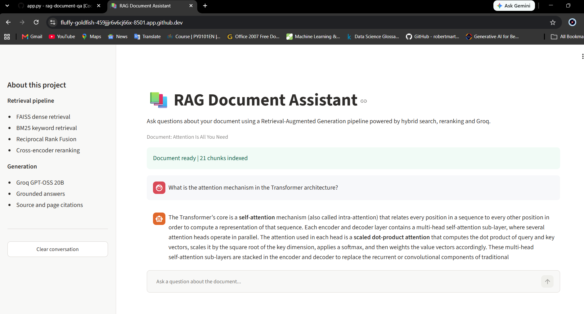

# RAG Document Q&A System

An end-to-end Retrieval-Augmented Generation (RAG) application that enables users to ask questions about PDF documents and receive context-grounded answers with source and page citations.

## Application Demo



*The application answering a question about the Attention Is All You Need research paper using hybrid retrieval and Groq GPT-OSS 20B.*

## Project Overview

This project implements a hybrid RAG pipeline combining dense vector retrieval, sparse keyword retrieval, Reciprocal Rank Fusion (RRF), and cross-encoder reranking to improve document retrieval quality.

The retrieved context is passed to Groq's GPT-OSS 20B model to generate answers grounded in the source document.

## Key Features

- **PDF Ingestion:** Extract text and metadata from PDF documents.
- **Token-Based Chunking:** 512-token chunks with 64-token overlap.
- **Semantic Search:** Hugging Face sentence-transformer embeddings.
- **Vector Database:** FAISS for dense similarity search.
- **Keyword Search:** BM25 for sparse retrieval.
- **Hybrid Retrieval:** Reciprocal Rank Fusion combines dense and sparse results.
- **Cross-Encoder Reranking:** Reorders retrieved chunks based on query relevance.
- **LLM Generation:** Groq GPT-OSS 20B generates context-grounded answers.
- **Source Citations:** Displays source document and page references.
- **Interactive UI:** Streamlit-based document question-answering interface.

## Architecture

```text
                 PDF Document
                       |
                 PDF Ingestion
                       |
                 Text Chunking
              (512 tokens, overlap 64)
                       |
                Hugging Face
                  Embeddings
                       |
                  FAISS Index
                       |
User Query ------------+
      |
      +-------------------------+
      |                         |
 Dense Retrieval           BM25 Retrieval
      |                         |
      +------------+------------+
                   |
          Reciprocal Rank Fusion
                   |
          Cross-Encoder Reranking
                   |
           Top Relevant Chunks
                   |
             Groq GPT-OSS
                   |
          Grounded Answer
                   |
          Source Citations
                   |
              Streamlit UI
```

## Technology Stack

| Component | Technology |
|---|---|
| Programming | Python |
| PDF Processing | PyMuPDF |
| Text Chunking | LangChain |
| Embeddings | Sentence Transformers |
| Vector Search | FAISS |
| Keyword Retrieval | BM25 |
| Hybrid Retrieval | Reciprocal Rank Fusion |
| Reranking | Cross-Encoder |
| LLM | Groq GPT-OSS 20B |
| Interface | Streamlit |
| Retrieval Evaluation | Hit Rate@K, Recall@K, MRR@K |

## Retrieval Evaluation

A ground-truth dataset containing five questions was created using the *Attention Is All You Need* research paper.

The following retrieval strategies were benchmarked:

1. FAISS Dense Retrieval
2. BM25 Sparse Retrieval
3. Hybrid Retrieval using RRF
4. Hybrid Retrieval with Cross-Encoder Reranking

Evaluation metrics:

- Hit Rate@K
- Recall@K
- Mean Reciprocal Rank (MRR@K)

Detailed and summary benchmark results are available in `evaluation/results/`.

RAGAS-based answer-quality evaluation is currently deferred.

## Project Structure

```text
rag-document-qa/
│
├── app.py
├── requirements.txt
├── README.md
├── .gitignore
├── .env.example
│
├── screenshots/
│   └── rag-document-assistant.png
│
├── data/
│
├── src/
│
├── evaluation/
│   ├── ground_truth.json
│   ├── benchmark.py
│   ├── metrics.py
│   └── results/
│
└── artifacts/
```

## Local Setup

### 1. Clone the repository

```bash
git clone https://github.com/YOUR_USERNAME/rag-document-qa.git
cd rag-document-qa
```

### 2. Install dependencies

```bash
pip install -r requirements.txt
```

### 3. Configure Groq API Key

Create a `.env` file in the project root:

```env
GROQ_API_KEY=your_actual_api_key
```

Get your API key from [Groq Console](https://console.groq.com/).

Never commit your `.env` file.

### 4. Run the application

```bash
streamlit run app.py
```

Open the local Streamlit URL displayed in the terminal.

## Future Improvements

- RAGAS-based answer-quality evaluation.
- Multi-PDF document ingestion.
- Improved retrieval and chunking strategies.
- Conversation memory.
- Cloud deployment.
- Performance and latency optimization.

## Current Status

The end-to-end RAG pipeline, hybrid retrieval benchmark, Groq-based answer generation, source citations, and Streamlit interface have been implemented and tested locally.

Cloud hosting is currently deferred.
